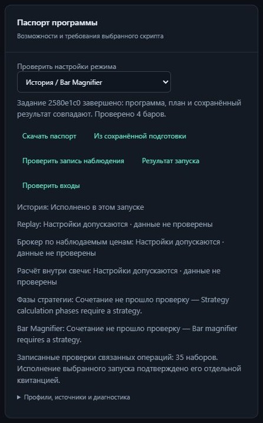

# Приёмка закреплённого запуска и квитанций исполнения

Код `f21340b757e9a265a514b6e33dd0394286143e8f` прошёл [полный CI](https://github.com/s7cret/openpine/actions/runs/40895355210) на Python 3.14.8:
**57/57 заданий**, **1360 тестов в 154 модулях на каждой ОС**, **2461 conformance-сценарий
на каждой ОС** (1634 исполнения и 827 ожидаемых отказов). Один общий wheel прошёл
18 установочных частей на Windows и Linux и четыре проверки восстановления.
Все 1349 прежних идентификаторов тестов сохранены; добавлено 11 тестов.

[Контракт и использование](BOUND_LAUNCHES.md).
[Независимый аудит, квитанции корпуса и хеши](evidence/bound-launch-20261029.json).

| Пункт плана | Принятый результат |
| --- | --- |
| Выбранные настройки | Веб передаёт реальные broker/intrabar/cycle/Magnifier параметры; конкретное сочетание проверяет прежний движок |
| Конкретные входы | Полное потоковое чтение закреплённых свечей, хеши, покрытие, прогрев и нужные метаданные инструмента через существующие правила подготовки |
| Magnifier | Настоящий streaming driver, полное покрытие/OHLCV младших свечей и правила видимости requested данных для v1–v6 |
| Устойчивая привязка | Хеши конфигурации, запроса, плана, программы и снимков; проверка перед первым enqueue и явный отказ устаревшему binding |
| Веб и CLI | Подготовка → проверка входов → запуск; сброс при изменении выбора, семь сценариев гонок и один отчёт CLI/HTTP |
| Квитанция результата | Только committed succeeded с совпавшим планом/программой/результатом и полными рядами подтверждает исполнение данного запуска |
| Корпус и приёмка | Все 50 исполняемых программ по новому пути на обеих ОС; прежние 56 программ, 6 отказов и 356 сравнений сохранены |

Прежние наблюдения всех **2461 conformance-сценария** совпали с предыдущей
приёмкой на обеих ОС: идентификаторы, исходники, ожидания и результаты.
Packages, spec, examples, conformance, зависимости, прежние Python-тесты и upgrade
fixture побайтно сохранены. Вычислительный хеш остаётся
`cfe2dd0d973532c215c85b4dca2e1f7a3ff89deefee39c5ef73b64ddac2dc5dd`; схема каталога остаётся **16**.

Все **56 программ корпуса** дополнительно прошли новый путь: 50 реальных
подготовок, проверок входов, worker-исполнений и положительных квитанций;
шесть ожидаемых отказов сохранены. Семантический хеш каждого из 50 результатов
совпал с его прежним source/IR-путём. Отдельные свидетельства нового пути совпали
между ОС; прежние 356 сравнений совпали и между ОС, и с предыдущей приёмкой.
Существующие replay этих программ проверены по байтам/последовательностям/цепочке
ленты, с отдельной отметкой сохранённого префикса и без продвижения исполнения.

В установленных wheel офлайн CLI проверил закреплённые подготовки v1–v6 после
освобождения владельцем каталога. Чтение не запустило задания. Исходный паспорт
CLI/HTTP сохранил равенство JSON. Браузер выполнил реальный пример на четырёх барах:
подготовка, проверка, worker, квитанция, скачивание. Скачанный отчёт совпал с
офлайн CLI за исключением времени новой проверки и его checksum; ошибок консоли
не было. Семь браузерных сценариев подтвердили защиту от поздних ответов и сброс
проверки при изменении исходника, режима или снимка.

Из фактического предыдущего принятого wheel создано состояние и продолжено
текущим приложением: исторический checkpoint с бара 2, replay на четырёх барах
и два варианта исследования; прежний результат сохранён. Это дополнительная
проверка предыдущего wheel наряду со штатными recovery-проверками CI.

На этой рабочей станции свободной RAM было меньше системного резерва продукта.
Локальные функциональные проверки использовали явно обозначенную фикстуру
недоступного host-замера либо фиксированный тестовый замер; лимиты заданий и
контроль RSS сохранились. Продуктовый допуск не ослаблен. Полный CI выполнялся
на обычных hosted runners с действующими замерами. Локальная GUI-проверка
не является нагрузочной приёмкой рабочей станции.

Проверка входов действует на момент чтения, не резервирует будущие RAM/диск/worker;
ресурсный допуск остаётся у supervisor. Очередь, пауза, ошибка, отмена и повреждённый
результат не подтверждают исполнение. Проверка replay-ленты подтверждает её запись,
а переходы событий проверяет движок во время исполнения. Записанный replay-префикс
остаётся отдельным от завершённого исторического запуска. Ни совпадение операций
с корпусом, ни положительная квитанция не означают эквивалентность TradingView.

