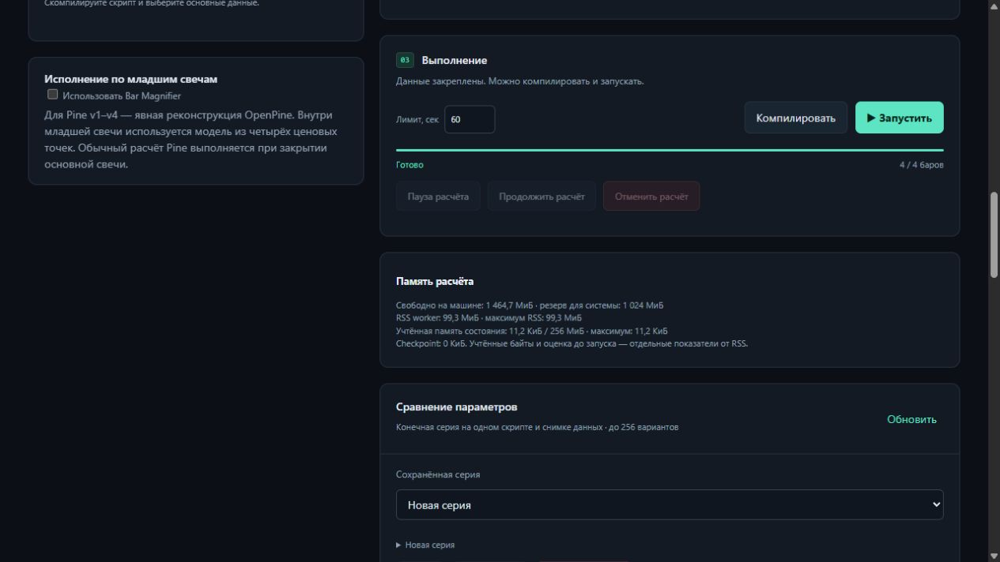

# Приёмка RAM и восстановления R6

Исходник: `e7a72e4aed4a21973fc2b5f21d39743b2c146265`. Python 3.14.8.
[CI 40734920466](https://github.com/s7cret/openpine/actions/runs/40734920466) — 53/53 jobs, Windows и Linux.
[Архитектура](LIVE_RECOVERY_ARCHITECTURE.md) · [машиночитаемые доказательства](evidence/live-recovery-20261028.json).

Реализованы все семь пунктов этапа:

1. Общий допуск по RAM машины для подготовки, чтения и workers; системный резерв,
   ожидание в очереди и автоматическое продолжение без расходования попытки.
2. Компактный точный SMA checkpoint: исходные doubles и одна целочисленная опора.
3. Блочный формат в ObjectStore, проверка бюджета до разбора каждого блока,
   ограничение всего декодированного дерева, явные ссылки для GC/backup.
4. Освобождение байтов после прогрева старых EMA/MACD и учёт содержимого строк;
   логическая квота ячеек сохранена отдельно.
5. Длительный realtime-прогон v1–v6 с rollback, пропусками вызовов, частными
   контекстами и восстановлением внутри свечи; varip/массивы в v4–v6.
6. Длительный прогон через настоящий JobManager/apps.worker с принудительным
   завершением worker и координатора; проверены значения, прочитанные из Parquet.
7. Панель RAM/RSS, учтённых байтов, checkpoint и причин ожидания в веб-интерфейсе.

| Проверка | Результат |
| --- | --- |
| Native на каждой ОС | 1264 теста, 142 модуля |
| Прежние test IDs | 1247 сохранены, удалённых нет; добавлено 17 |
| Conformance на каждой ОС | 2419: 1601 исполнение и 818 ожидаемых отклонений; прежние наблюдения совпадают |
| Установленный wheel | 18 прежних suites на каждой ОС; прежний состав helpers сохранён |
| Локальные проверки финального исходника | 40 целевых тестов прошли |
| Общий wheel | локальная сборка из frozen checkout и CI совпадают по всем членам архива |
| Managed recovery | 100,000 основных баров, 2 частных рынка, 3 попытки; 3,000,000 значений Parquet проверены |
| Realtime | 304,128 событий v1–v6; 64 предварительных обновления на бар |
| Прежняя крупная композиция | 1,000,002 событий; 10,000,020 значений проверены онлайн и повторно из Parquet |

Длительные прогоны закреплены в финальном CI job и выполняются последовательно.
Их оригинальные отчёты сохраняются в артефакте `r6-acceptance`; исходные test,
specification и installed receipts проверяются перед ними. Число CI jobs — 53.

Managed-прогон восстановился с бара 10,000. Учтённый
пик состояния — 35.36 МиБ; размер последнего
checkpoint — 1.35 МиБ.
В realtime максимальный разброс учтённой памяти после прогрева составил
0 байт; максимальный разброс
RSS в последней четверти прогона — 0.00 МиБ.
В миллионной композиции пик RSS — 199.25 МиБ,
учтённый пик — 35.36 МиБ.

Полный локальный прогон предыдущего кандидата остановился на отказах допуска,
когда свободная RAM упала примерно до 1,35 ГиБ. Он сохранён как неуспешная
ресурсная попытка и не включён в число прошедших проверок. Лимиты не отключались;
полный набор финального исходника прошёл на обеих ОС в CI. Локально после этого
прошли целевые проверки и сравнение 2419 прежних наблюдений. Приложения пользователя
не завершались.

Размер checkpoint относится к уникальным блокам состояния/выходного префикса;
свечи и большие ряды остаются отдельными неизменяемыми объектами. Учтённые байты,
статическая оценка и RSS — разные показатели. Блочная загрузка ограничивает разбор
и итоговое примитивное дерево; runtime затем восстанавливает состояние целиком
с отдельной проверкой квот и атомарной публикацией. Слишком большой старый JSON
отклоняется до разбора. Идентичности несовместимых старых реализаций не мигрируют
автоматически. Точное сравнение с TradingView остаётся отдельным этапом.
