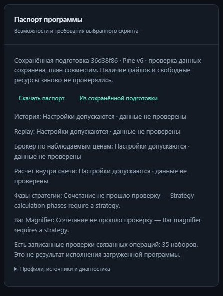

# Приёмка паспорта программы v1–v6

Код `631e8dfca70477da909664b094dced21c541c534` прошёл [полный CI](https://github.com/s7cret/openpine/actions/runs/40861882784) на Python 3.14.8:
**57/57 заданий**, **1349 тестов в 152 модулях на каждой ОС** и
**2461 conformance-сценарий на каждой ОС** (1634 исполнения, 827 ожидаемых отказов).
Все 1331 прежних идентификатора тестов сохранены; добавлено 18 тестов.

В предварительном CI прежний тест падения воркера остановился по JOB_TIMEOUT
после 77 001 из 100 000 свечей: он наследовал 60 секунд от маленького примера.
Этому тесту выделено 180 секунд и 240 секунд ожидания; объём данных, падение,
checkpoint, resume и точное сравнение результатов сохранены (сверены по AST).
Локальная проверка прошла. Итоговый CI целиком запущен заново для указанного выше
коммита. Хеши исходного неуспешного лога и квитанции сохранены в аудите.

[Контракт и использование](PROGRAM_PASSPORT.md).
[Независимая сверка квитанций и хеши](evidence/program-passport-20261029.json).

| Пункт плана | Принятый результат |
| --- | --- |
| Каталог возможностей | Общая проекция закреплённых профилей, происхождение и SHA; прежний tools API сохранён |
| Паспорт IR | Версия Pine, операции, call sites, профили, inputs, контексты и существующая оценка истории/памяти |
| Сочетания режимов | Действующие правила history/replay/observed/intrabar/cycle; Magnifier требует настоящего плана с данными |
| Подготовка | Opt-in расширение прежнего requirements и отдельное чтение сохранённой подготовки без её продвижения |
| Диагностика и свидетельства | Исходные координаты отказов; импорт, допуск, записанные проверки и реконструкция разделены |
| CLI и веб | Один отчёт, исходник и сохранённый IR v1–v6, оригинальный JSON, защита от поздних ответов |
| Сохранность и приёмка | Прежний корпус и наблюдения сохранены; один wheel, 18 installed suites на каждой ОС, 4 recovery-проверки |

Независимая сверка подтвердила точное совпадение **всех 2461 прежних наблюдений**
на обеих ОС: идентификаторов, исходников, ожиданий и наблюдаемого результата.
Исходные файлы packages/spec/examples, conformance-фикстуры, зависимости и upgrade
fixture побайтно сохранены. Описательный обход признаков IR перенесён из conformance
в общий модуль без изменения AST функции.

Корпус остаётся из **56 программ: 50 исполнений и 6 ожидаемых отказов**,
с **356 применимыми сравнениями**. Переносимые квитанции пяти частей корпуса
совпали между Windows/Linux и с предыдущей принятой версией.
Паспорт отдельно проверен на всём корпусе. В установленных wheel обеих ОС
CLI/HTTP дали одинаковый отчёт для v1–v6; параметры не разрешают исполнение
без проверки данных и ресурсов.

Четыре браузерные проверки подтвердили защиту от позднего результата и ошибки,
сброс при изменении исходника и сохранение исходного JSON `2.0` при скачивании.
Скачанный из настоящего приложения отчёт совпал с текущим describe; ошибок
браузера не было. Проверены исходник и сохранённая подготовка. Последняя
передаёт сохранённые настройки брокера; HTTP-регрессия проверяет это отдельно.

Каталог остаётся на схеме **16**, вычислительная идентичность сохранена:
`cfe2dd0d973532c215c85b4dca2e1f7a3ff89deefee39c5ef73b64ddac2dc5dd`.
Изменилось только происхождение сборки. Из настоящего предыдущего
квалифицированного wheel создано состояние и продолжено текущим приложением:
история со второго бара, replay на четырёх барах и два варианта исследования;
прежний результат сохранился. Это отдельная проверка реального предыдущего wheel,
в дополнение к штатным CI-проверкам восстановления.

Паспорт описывает допустимость конфигурации и требуемые входы. Он не подтверждает
исполнение всей загруженной программы, текущую доступность файлов или свободные
ресурсы. Записанное пересечение операций с корпусами не является процентом
поддержки Pine. Точная эквивалентность TradingView остаётся отдельным этапом.

