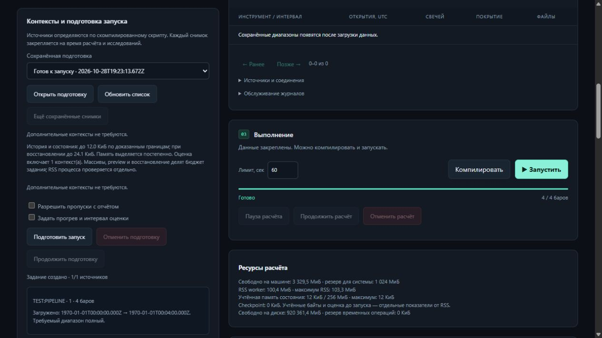

# Приёмка жизненного цикла ресурсов R6

Все семь пунктов инфраструктурного этапа закрыты на исходнике
`c9cb0fba054f6e8d2c8334d5e13342411836010c`. [CI — 57/57](https://github.com/s7cret/openpine/actions/runs/40764192511),
Python **3.14.8**, запуск №1.

## Что изменилось

| Пункт | Принятое поведение |
| --- | --- |
| Общий supervisor | История, replay и batch используют общий запуск, heartbeat, deadline, RSS, отмену, kill/reap; координатор владеет процессами |
| Допуск по диску | Lease резервирует временное место, учитывается свободный остаток; ожидание сохраняет опубликованный префикс; SQLite-индекс сделок удаляется после освобождения попытки |
| Память checkpoint | Запись проверяет тот же ограниченный decoder, который использует восстановление; заголовок проверяется по мере сборки |
| Потоковое состояние | История, ядра и объекты heap сохраняются и читаются отдельными ограниченными записями; замена native-состояния остаётся атомарной |
| Справедливая очередь | Классы live/history/research, FIFO, round robin, aging и приоритет ожидающего live для последнего слота; API/UI показывают причину ожидания |
| Полное восстановление | Смешанная работа, падение worker/координатора, backup, новая папка, GC и продолжение с одинаковыми результатами |
| CI | Один wheel, ограниченная конкуренция installed jobs, длинные проверки после build и один итоговый gate со всеми отчётами |

Подробнее: [архитектура](RESOURCE_LIFECYCLE_ARCHITECTURE.md).

## Регрессия и поставка

- **1286 тестов / 144 модуля на каждой ОС** — Windows и Linux.
  Все **1264** прежних ID сохранены; добавлены **22** теста.
- Все **2419** прежних наблюдений совпали на обеих ОС: **1601** исполнение
  и **818** ожидаемых отказов. Корпуса, golden-файлы и закреплённая спецификация сохранены.
- **18 installed suites на каждой ОС**, один общий wheel; локальная замороженная
  сборка совпала с CI по байтам всех **4320** членов архива.
- Исходник: `119928359e7c875202949fab27343554bb995adc0bbae78b62f8833c22f8e645`.
  Wheel CI: `b0603dc8421ea9493fbc8137419b0af9017e3ab1abfb49eebef767bd60f52604`.
- Итоговый receipt `openpine.ci-acceptance.2` требует все четыре длинных отчёта,
  проверяет их source/wheel identity и контрольные суммы. Пропуски и смешанные
  исходники отклоняются.

## Длинные проверки

| Проверка | Результат |
| --- | --- |
| Worker и координатор | 100,000 баров, 3 попытки, восстановление с бара 10,000; прочитаны и проверены 3,000,000 значений Parquet |
| Realtime v1–v6 | 304,128 событий; rollback, varip/массивы в доступных версиях, восстановление внутри открытого бара; плато RAM/RSS |
| Миллион событий | 1,000,002 событий; проверены 10,000,020 вычисленных и столько же сохранённых значений в двух процессах |
| Всё хранилище | 100,000 баров, 2 research-варианта, 2,048 replay-баров; backup → restore → GC → продолжение; идентичные result/checkpoint ID и значения |

Нехватка диска проверена управляемым отказом допуска и инъекцией ENOSPC в
публикацию. Прежний replay-префикс сохранён. Это fault injection, а не заполнение
диска пользователя.

## Локальная проверка

На том же исходнике прошли **43 профильных теста** и **52 теста связанных
pipeline/storage-механизмов**, включая 7 сквозных тестов Bar Magnifier; всего
**76 различных ID**. Смешанное восстановление на 20 000 барах
повторно проверило **600 000** значений, два research-варианта и 2048 replay-баров.
Полная матрица исполнялась в CI на обеих ОС.

Браузерная проверка подтвердила ожидание RAM и диска, автоматическое продолжение
того же задания и результат демонстрационного расчёта `135 / 5 / 30`.
Проверка интерфейса выполнена на `e7c269a`; все файлы `apps/ui/` побайтово
совпадают с принятым исходником. Пробы давления в этом UI-тесте были подставлены
в отдельный тестовый сервер.

## Границы результата

RSS измеряется периодически; нативный жёсткий лимит ОС этим этапом не вводится.
Допуск по диску координирует одно хранилище и оставляет обработку ENOSPC для
внешних писателей. Потоковое восстановление материализует одну ограниченную
запись за раз. Очередь не вытесняет уже работающий процесс.
Новые конструкции Pine не добавлены; точное сравнение с TradingView остаётся
отдельным этапом.

Полная машинная [приёмка и хеши](evidence/resource-lifecycle-20261028.json).
