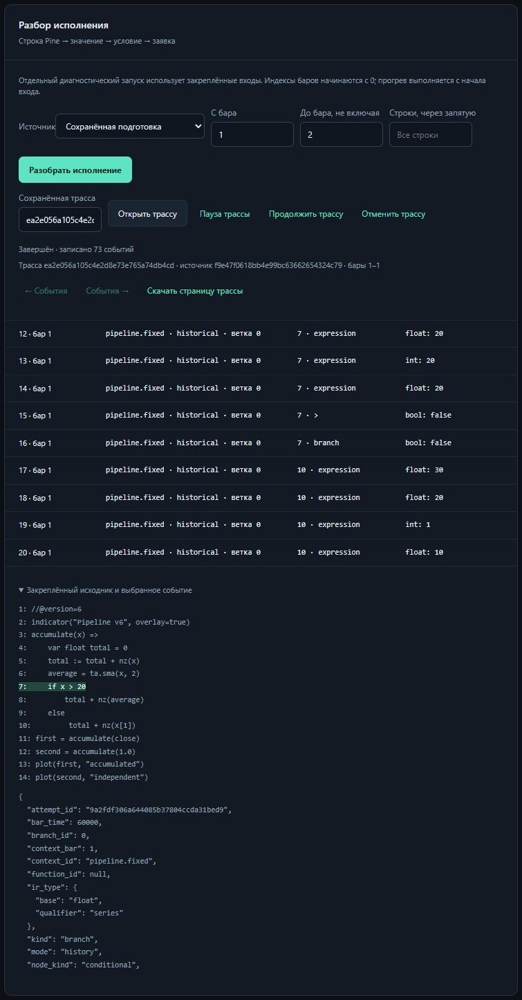

# Приёмка разбора исполнения v1–v6

Код `6fd6c70706a846d187a6da881506bdf900be0004` прошёл [полный CI](https://github.com/s7cret/openpine/actions/runs/40928594571) на Python **3.14.8**:
**57/57 заданий**, **1376 тестов в 158 модулях на каждой ОС**, **2461 conformance-сценарий
на каждой ОС** — 1634 исполнения и 827 ожидаемых отказов. Один общий wheel прошёл
18 установочных частей на Windows/Linux и четыре проверки восстановления.
Все 1360 прежних идентификаторов тестов сохранены, добавлено 16.

[Контракт, ограничения и команды](TRACING.md).
[Независимый аудит и квитанции](evidence/trace-20261029.json).

| Пункт плана | Принятый результат |
| --- | --- |
| Контракт | Программа, план, входы, binding, попытка, контекст, бар, фаза, source span и ограниченные события |
| Вычисления | Фактические выражения, присваивания, UDF, условия и выходы существующего evaluator |
| Контексты и ветки | Видимость requested данных, прогрев, preview/commit/discard, varip, cycle и Magnifier |
| Сделки | Наблюдение реальных намерений и событий прежнего брокера с привязкой к call site |
| Ресурсы | Явное включение, окно баров, потоковые чанки, ограниченные значения, усечение и возврат к прямому evaluator |
| CLI и веб | Повтор закреплённых входов, страницы событий, сохранённый исходник и переход к строке, экспорт и управление |
| Приёмка | Равенство trace-on/off, native state, восстановление, отмена, GC/backup, корпус и полная приёмка обеих ОС |

Все **2461 прежнее conformance-наблюдение** сохранилось на обеих ОС: идентификаторы,
исходники, ожидания и фактические результаты. Spec, examples, case fixtures,
зависимости и прежние Python-тесты побайтно сохранены. Отчёты conformance
перегенерированы под новый вычислительный хеш. Схема SQLite остаётся **16**.

В установленном wheel на обеих ОС все **50 исполняемых программ** получили
отдельный исторический diagnostic worker и изолированный replay-префикс.
Результаты истории, график replay, симуляция и страницы журнала совпали с
обычным исполнением, исходные записи сохранены. Шесть прежних отказов и
**356 сравнений** корпуса сохранены; переносимые квитанции совпали между ОС.
Число сравнений с изменившимся native-хешем относительно предыдущей сборки:
**100 на ОС**; такие различия явно перечислены в аудите.
Ещё **72 хеша на ОС** изменились из-за ID заявок/исполнений/сделок:
прежний брокер выводит их из хеша программы. Отдельно исполнены все 50 программ
старым принятым wheel и текущим кодом. Сырые результаты совпали с прежними
квитанциями и текущим CI; после замены только математически проверенных
производных ID все значения, события, цены, количества, связи и статистика
истории и replay совпали точно. Правило замены и хеши приведены в аудите.
Сравнения нового native state fresh/resumed по-прежнему проходят.
CLI `trace run/events` проверен для v1–v6 на обеих ОС с равенством HTTP-страниц.

Веб выполнил текущую сборку на четырёх барах: для основного бара 1 записаны
**73 события**, выбранное условие `if x > 20` вернуло `false`, подсвечена
строка 7 сохранённой программы. Скачанный JSON совпал с API, ошибок консоли
нет. Шесть браузерных сценариев проверили поздний исходник, позднюю ошибку,
изменение диапазона, безопасное текстовое отображение значений и очистку
прежних подробностей при загрузке новой или пустой трассы.

Дополнительная локальная проверка **10 003 replay-событий** остановила настоящий
worker после бара 100, переоткрыла координатор и продолжила тот же native prefix.
Отдельный worker отменён после committed checkpoint; префикс сохранён.
Архивный Parquet-блок разделён по ссылке, JSON хранит только хвост,
копируемых строк индекса replay — **0**. После GC и backup/restore обе трассы
и диапазон ленты сохранились. Подмена JSON-хвоста с новым корректным хешем
файла и неверной hash chain отклонена до выдачи событий. Исходный replay не продвинут.

Потоковый эксперимент на **100 тысячах, миллионе и 10 миллионах баров** дал
одинаковые хеши выходов и native state при включённой и выключенной трассе.
Для выбранных первых десяти баров суммарный размер сериализованных событий
оставался **39976 байт** и **70 событий** на всех трёх размерах
(manifest и JSON-обрамление учитываются отдельно). Максимальный измеренный
RSS процесса — примерно **82.7 МиБ**. Здесь синтетический streaming source
и hash-only sink; это проверка ограниченности evaluator/наблюдателя, а не
нагрузочная приёмка всего HTTP/Parquet-пути. Времена описательные: на рабочей
станции одновременно выполнялись другие процессы. Отдельное сравнение со старым
wheel на 100 тысячах баров сохранило хеш всех выходов.

Вычислительная идентичность изменилась:
`eb4243728a306ec127a339b6691a10275142be257fd8851887dba7ca7160cac9`.
На реальном предыдущем принятом wheel подготовлено состояние: текущая сборка
отказала старому native checkpoint с `PLAN_IMPLEMENTATION`, сохранила его
и прежний результат, а явная перекомпиляция на тех же входах завершилась успешно.
Автоматического переноса native state между этими вычислительными версиями нет.

Локальные функциональные прогоны использовали явно обозначенный fallback
недоступного host-замера; бюджеты задания и контроль RSS оставались активны.
CI выполнялся с обычными замерами hosted runners. Продуктовый допуск не ослаблен.

Трасса ограничена выбранным диапазоном и может усекаться. Полный прогрев и
расчёт выполняются обычным движком. Replay-диагностика закрепляет конкретный
префикс; завершённая диагностика префикса не подтверждает всю программу.
Диагностические записи пока сохраняются без отдельного автоматического TTL.
Точное сравнение с TradingView остаётся самостоятельным этапом.

