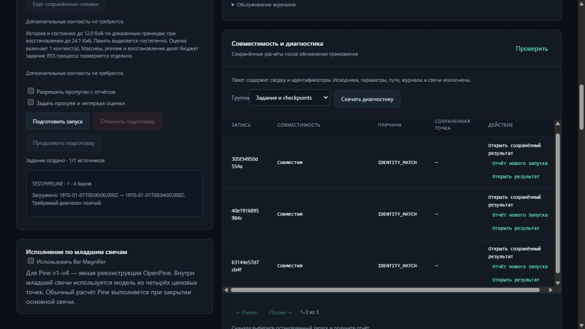

# Приёмка управляемого обновления R6

Семь пунктов приняты на исходнике `aa6c1eedc9df78a24f3e4b118b2084637c05e28f`.
[CI — 57/57](https://github.com/s7cret/openpine/actions/runs/40780215865), Python **3.14.8**, Windows и Linux.
Вычислительная идентичность и закреплённая спецификация сохранены.

| Пункт | Принятое поведение |
| --- | --- |
| Актуальная архитектура | [Эксплуатационное руководство](OPERATIONS.md), схема каталога **16**, исторические документы помечены отдельно |
| Диагностика без записи | `doctor`, полный обход и `storage inspect` читают частную копию SQLite + WAL; исходные файлы не мигрируют и не создаются |
| Совместимость | Программы, jobs/checkpoints, replay, live, варианты исследований, holdouts и подготовки; причина и доступное действие |
| Управляемое обновление | Эксклюзивные manager/attempt leases, точный backup исходной схемы, receipt, повтор после прерывания, аудит и restore в новую папку с сохранением схемы |
| Явная перекомпиляция | Preview + request ID, новая программа и job с прежними данными/inputs/ресурсами; job/plan/lineage атомарны; старый checkpoint не используется |
| CLI и веб | Причина остановки, сохранённая точка, доступ к старому результату, создание нового расчёта по отчёту; ограниченный диагностический экспорт |
| Две сборки и поставка | Предыдущая production-сборка из принятого wheel и текущая установка; совместимый и несовместимый переходы на обеих ОС, один общий wheel и итоговый gate |

## Регрессия

- **1312 тестов / 146 модулей на каждой ОС**. Все **1286** прежних ID
  сохранены; добавлено **26**, снятых нет. Проверка старой миграции сохраняет
  свой ID и теперь требует явную команду upgrade перед открытием приложения.
- Все **2419** прежних conformance-наблюдений совпали на обеих ОС:
  **1601** исполнение и **818** ожидаемых отказов. Новые конструкции Pine
  этим этапом не добавлялись.
- **18 installed suites на ОС**, прежние 12 native shards, четыре длинные
  проверки восстановления и один итоговый gate. Installed helper `upgrade`
  добавлен в существующий suite `targets`; состав прежних helpers сохранён.
- Локальный wheel и wheel CI совпали по байтам всех **4338** членов;
  ZIP-компрессия может давать другой SHA архива.

Исходник: `da1b4f0156f4be9e4bc5a2f07e3ed8ad8a893ece1353bf058c3fa8f0453980e8`.
Вычисления: `865e2c9c519dda2707179c6b71797d3a157e450ab3eb4f18ba0d25a5f43344ea`.
Wheel CI: `5d5f67049c383db5032178cd2760516d351bc80fa2d2373354402ba477965be9`.

## Обновление и сбои

Реальные отдельные процессы завершались на пяти границах: план, опубликованный
backup, незавершённая SQL-миграция, мигрированный каталог и завершённый аудит.
SQLite откатывает незавершённую транзакцию; повтор той же операции использует
проверенный backup и доводит receipt до `complete`. Обычное открытие незавершённого
обновления блокируется. Успешный повтор возвращает прежнюю квитанцию.
Отказы backup, занятый manager/исторический/replay lease, смена target identity
и повреждение backup проверяются отдельно.

Backup сохраняет схему **15** и все immutable objects, в том числе неиспользуемые.
`restore --preserve-schema` восстанавливает исходную версию в новую папку.
Старый каталог не перезаписывается откатом. Для версии 1 отдельно проверены
сохранность исходных байтов входа и прежнее заполнение отсутствующего RunPlan
после явного обновления.

## Переход двух сборок

Офлайн-baseline содержит **411** файлов из предыдущего принятого wheel
`b0603dc8421ea9493fbc8137419b0af9017e3ab1abfb49eebef767bd60f52604`. Все `packages/`, `apps/` и `spec/`
предыдущей сборки сохранены; каждый архивный член побайтово сверен с исходным
wheel. Identity production-дерева проверяется перед созданием состояния.
Это архив тестовой поставки внутри того же репозитория, а не отдельный модуль
или сетевой источник во время теста.

На **Windows и Linux** предыдущая сборка создаёт сохранённую историю,
replay-checkpoint и исследование. После перехода схема становится **16**,
история продолжается с **бара 2**, replay достигает **4 баров**, завершаются
**два варианта исследования**, прежний результат и исходный план сохраняются.
При изменении вычислительного файла в изолированной копии старое продолжение
реально получает **`PLAN_IMPLEMENTATION`**. Новый запуск требует preview,
перекомпилирует сохранённый исходник и заканчивается успешно без старого
checkpoint. Дополнительно локально проверен полный исходный wheel предыдущей
поставки. Производственный checkout этими опытами не изменялся.

Повтор apply с тем же request ID возвращает ту же квитанцию. Ошибка публикации
lineage откатывает одновременно job и plan. Удаление нового задания оставляет
ключ зарезервированным (`RESTART_GONE`). Inputs, снимки, контексты и ресурсная
политика не меняются молча; несоответствующая input schema требует новой настройки.

## Приложение и длинные проверки

Браузер подтвердил сохранение прежних результатов, создание отдельного нового
задания из preview, итог **135 / 5 / 30** на четырёх барах и скачивание
диагностического пакета. В консоли не было предупреждений или ошибок.
Браузерная проверка и 78 локальных dev-тестов выполнены на `cb94d12`;
все production-файлы и существующие Python-тесты побайтово совпадают с принятым
исходником. Последующее дополнение добавило fixture/tooling для CI. Установленный
wheel с этим дополнением проверен отдельно на окончательном исходнике.

Диагностический экспорт ограничен по размеру и исключает исходники, inputs,
пути, логи, тексты ошибок и свечи. Пакет не отправляется третьим сторонам.
Временные локальные серверы и вкладка проверки закрыты.

Повторно пройдены все четыре длинные проверки: реальные падения worker/координатора,
realtime v1–v6 с rollback/плато памяти, миллион событий с чтением сохранённых
значений и смешанное хранилище backup → restore → GC → продолжение. Итоговый
`openpine.ci-acceptance.2` сверяет один source/wheel и требует все четыре отчёта.
Оригинальные ZIP-артефакты CI и их контрольные суммы сохранены в локальной приёмке.

## Границы

Read-only копия каталога ограничена **512 МиБ**, при активных изменениях требуется
повторить наблюдение. Сам upgrade не имеет этого ограничения копии и требует
эксклюзивного обслуживания. Проверка совместимости не восстанавливает весь
native-checkpoint и не обещает ресурсы для будущего исполнения: это проверяется
при запуске worker. Артефакт без исходника автоматически не декомпилируется.
Точная эквивалентность TradingView остаётся отдельным этапом.

Команды и порядок обновления: [OPERATIONS.md](OPERATIONS.md).
Полная машинная [приёмка и хеши](evidence/upgrade-20261029.json).
